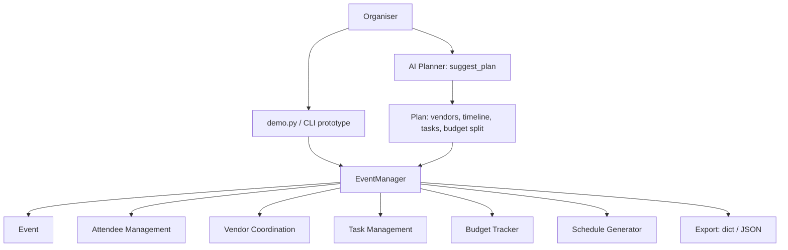

# TekunoAI - AI Powered Event Management

**Status: MVP prototype in active development**

Founder: Raghav Shah
Startup: TekunoAI

> This is an early prototype built to demonstrate the product concept and core
> workflows. It does not claim customers, revenue, or funding.

## Problem

Planning an event means juggling dozens of moving parts in spreadsheets,
chats, and email threads:

- Who is invited, who confirmed, and what do they need?
- Which vendors are booked, what do they cost, and when do they arrive?
- What happens at what time on the day?
- Is the event still inside budget?

Details get missed, vendors get double-booked or arrive late, budgets drift,
and organisers spend more time coordinating than hosting.

## Solution

TekunoAI Event Management brings the whole plan into one place and uses an
AI planner to draft a workable first plan from just two inputs: the type of
event and how many guests are expected.

From that starting point, an organiser can refine attendees, vendors, tasks,
schedule, and budget in one system instead of five disconnected tools.

## Features

- **Event creation**: create events with name, type, date, location, expected
  guest count, and total budget.
- **Attendee management**: add attendees, track RSVP status, contact details,
  dietary needs, and VIP flags. See confirmed / invited / declined counts.
- **Vendor coordination**: add vendors by category (venue, catering, AV,
  decor, photography, entertainment, and more), track cost, contact, and
  booking status.
- **Schedule generation**: auto-generate a timed timeline for the event day
  from the event type, with setup, arrival, main programme, food, and
  wrap-up blocks.
- **Budget tracking**: track budget vs committed vendor cost and recorded
  spend, with remaining budget, utilisation percentage, and over-budget
  detection.
- **Task management**: create tasks with owner, priority, and status, so
  nothing depends on memory.
- **AI planner (prototype)**: `suggest_plan(event_type, guest_count)` returns
  a suggested venue capacity, vendor checklist, staffing hints, timeline,
  starter tasks, and a budget allocation. The current planner is
  deterministic and rule-based, using only the Python standard library.
  LLM-backed planning is on the roadmap below.
- **Export**: export the full event plan as a dictionary / JSON for sharing
  or persistence.

## Architecture



See [docs/architecture.md](docs/architecture.md) for component details.

## Tech Stack

- Python 3.10+
- Python standard library only (`dataclasses`, `datetime`, `enum`, `json`,
  `unittest`) - no external dependencies for the prototype core
- Tests: `unittest`
- Planned (roadmap, not in this prototype): FastAPI backend, web frontend,
  database persistence, LLM integration for the planner, calendar and
  messaging integrations

## How to Run

Clone or download this repository, then from the repository root:

```bash
# Run the end-to-end demo
python3 demo.py

# Run the tests
python3 -m unittest discover -s tests -v
```

The demo creates a sample corporate event, adds attendees and vendors,
generates a schedule, tracks budget, asks the AI planner for suggestions,
and prints the full event plan as JSON.

### Quick example

```python
from tekunoai_events import EventManager
from tekunoai_events.planner import suggest_plan

plan = suggest_plan("wedding", guest_count=150)
print(plan["budget_allocation"])
print(plan["vendor_checklist"])

manager = EventManager()
event = manager.create_event(
    name="Product Launch",
    event_type="corporate",
    event_date="2026-11-15",
    location="San Diego, CA",
    expected_guests=80,
    budget_total=12000,
)
manager.add_attendee("Alex Example", email="alex@example.com")
manager.add_vendor("City Catering", category="catering", cost=3500)
print(manager.generate_schedule())
print(manager.budget_summary())
```

## Project Layout

```text
tekunoai-event-management/
  README.md
  LICENSE
  demo.py
  tekunoai_events/
    __init__.py
    models.py       # Event, Attendee, Vendor, Task data models
    manager.py      # EventManager: attendees, vendors, tasks, budget, schedule
    planner.py      # AI planner prototype: suggest_plan()
  docs/
    architecture.md
  tests/
    test_event_management.py
```

## Roadmap

- [x] Core domain models and in-memory event manager (this prototype)
- [x] Rule-based AI planner for event type + guest count
- [x] Auto schedule generation and budget vs spend tracking
- [ ] Persist events to SQLite / JSON files
- [ ] REST API (FastAPI) on top of the core module
- [ ] Web dashboard for organisers
- [ ] LLM-backed planner that reasons over budget, venue, and vendor data
- [ ] Vendor outreach and attendee RSVP via email / messaging
- [ ] Calendar export (iCal) and day-of notifications
- [ ] Multi-agent coordination: separate agents for vendors, attendees,
      and logistics negotiating and resolving conflicts (part of the wider
      TekunoAI agent platform)

## About TekunoAI

TekunoAI is a startup founded by Raghav Shah, building AI-native digital
products, including:

- An AI-assisted SDLC management system
- AI powered event management (this repository)
- An AI agent platform where agents can negotiate on behalf of users and
  services for shopping and purchasing

## License

MIT - see [LICENSE](LICENSE).
